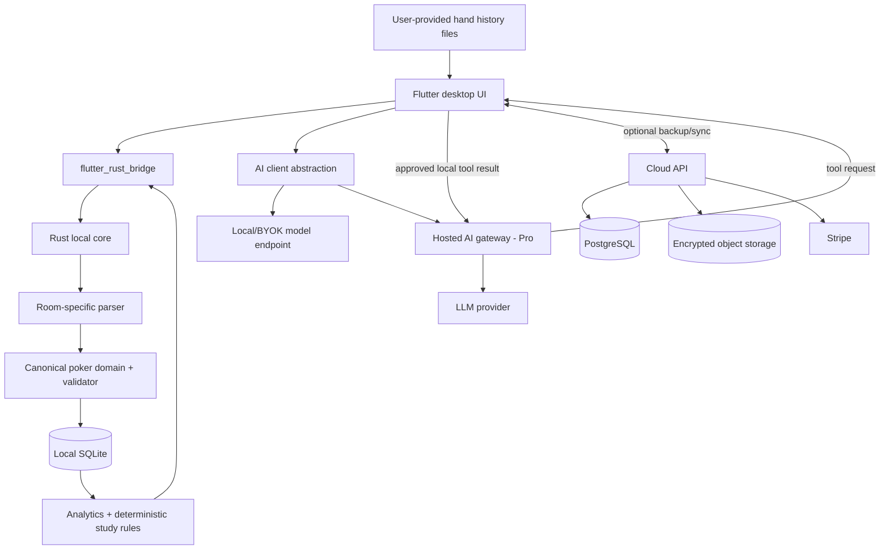
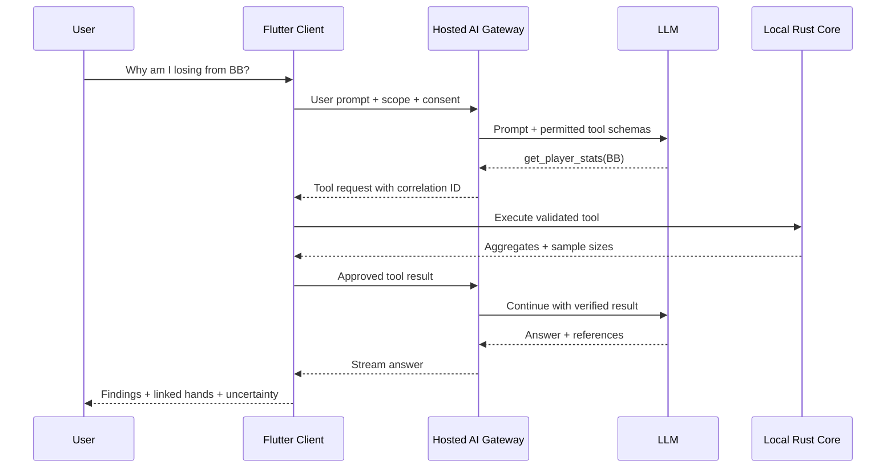

# Poker Study Platform — Technical Architecture & Implementation Blueprint

**Status:** Proposed baseline (implementation-ready, pending short technical spikes)  
**Version:** 0.1 · **Date:** 2026-10-16  
**Audience:** Solo founder/developer, contributors, coding agents  
**Product:** Local-first, free/open-source poker study platform with optional paid AI coaching and managed multi-device sync.

> **Scope:** This document is a technical plan, not evidence that individual provider policies, licenses, pricing, or SDK compatibility have been verified. Pin dependency versions after the initial spikes. All AI-assisted implementation must be reviewed and tested.

---

## 0. Executive decisions

| Decision | Baseline | Notes |
|---|---|---|
| Product | Desktop-first poker **study** platform | No real-time strategic advice |
| Client | Flutter / Dart | Windows, macOS, Linux first; mobile companion later |
| State management | `flutter_bloc` | Cubit for simple flows, Bloc for event-driven processes |
| Core | Rust | Canonical domain, parsers, evaluation, analytics, study rules, persistence |
| Dart–Rust bridge | `flutter_rust_bridge` | Expose coarse-grained typed commands; do not expose SQL |
| Local database | SQLite managed by Rust | `sqlx` + SQLite, WAL on desktop, migrations, one DB owner |
| Local AI | Configurable OpenAI-compatible endpoint | Ollama/LM Studio where compatible; capabilities negotiated |
| Hosted AI | TypeScript AI gateway | Server controls quotas and billing; client executes local tools |
| Backend | Hono + TypeScript, modular monolith | Node runtime on a small VM initially |
| Cloud database | PostgreSQL + Drizzle | Managed Postgres; choose Supabase Auth **or** Better Auth, not both |
| Auth initial choice | Supabase Auth | Verify token/JWKS and account mapping on server |
| Storage | S3-compatible object storage (R2 candidate) | Encrypted snapshots, attachments |
| Billing | Stripe Billing | Server-side entitlements, verified webhooks |
| Hosting | Docker Compose on Hetzner-class VM | Managed DB, object storage, no Kubernetes |
| Repositories | 2: public product + private cloud | Contracts published from public repo; versioned |
| License | Apache-2.0 candidate | Review dependency licenses, trademark and contribution policy |
| Sync | Encrypted snapshot backup first; incremental later | No naive SQLite file copying during live writes |
| AI | Deterministic tools + LLM explanation | No unsupported claims of GTO optimality |

### Product principles

1. **Free is complete:** no login, no subscription, no network required for parsing, tracking, analytics, replayer and deterministic study tools.
2. **Pro is a service:** hosted AI, managed backup/sync, convenience features; optional local AI/BYOK remains possible in Free.
3. **Offline is the default:** local SQLite is the authoritative data store for a device; cloud is an optional replica/backup.
4. **One domain owner:** Rust owns canonical poker models and local persistence. Dart owns UI state, not poker rules.
5. **Deterministic before generative:** calculate facts with tested algorithms; let LLMs explain, contextualize and teach.
6. **No live coaching:** AI coaching and advanced strategic analysis operate in post-session study workflows only.
7. **Build vertically:** ship one end-to-end working slice before expanding variants, rooms, or platforms.

## 1. Scope and non-goals

### MVP v0.1 (Community)

- NLHE cash-game hand history import from **one supported format** (initial candidate: PokerStars text exports).
- Correct parsing of blinds, ante if present, actions, all-ins, uncalled bets, side pots, showdown, rake, payouts.
- Canonical normalized hand model and robust error reporting.
- Local SQLite import with deduplication and parser version provenance.
- Core statistics (hands, net winnings, VPIP, PFR, 3-bet, fold-to-3-bet, steal/defense where definable).
- Filtering by date, stakes, position, game, session, player and relevant action opportunities.
- Hand replayer, basic graphs and export/backup.
- Automated builds for the primary desktop OS, then additional desktop OSes.

### MVP v0.2 (Study + BYOK)

- Deterministic leak candidates with sample-size safeguards.
- Study notes, saved hands, tags, hand review queues.
- Tool-based AI coach through user-configured provider, **post-session only**.
- AI answer provenance: statistics, hand references, strategy source references, uncertainty.

### First commercial release

- Hosted AI with quotas, payment, entitlement and usage tracking.
- Encrypted backup and device restore (snapshot approach).
- Multi-device incremental sync only when correctness and key management are demonstrated.

### Explicit non-goals for the first release

- Real-time decision assistance or table scraping.
- Full GTO solver, precomputed commercial GTO library, PLO, tournaments, ICM, multi-room universal HUD.
- Social network, marketplace, opponent data sharing, automatic hand importing from restricted clients.
- Multi-agent autonomous AI system, vector DB, Redis, Kafka, Kubernetes, cross-device live collaboration.

## 2. Context and data flow



**Privacy boundary:** A hosted LLM can only receive approved tool results and messages necessary for the user's request. Sync ciphertext should not be implicitly decrypted or routed into the AI service. Nicknames, file paths and identifying data are redacted where possible.

## 3. Repository strategy

### 3.1 Public repository: `poker-platform`

```text
poker-platform/
├── apps/
│   └── desktop/                     # Flutter application (mobile targets later)
│       ├── lib/
│       │   ├── app/                 # router, composition root, themes
│       │   ├── features/
│       │   │   ├── import/
│       │   │   ├── dashboard/
│       │   │   ├── hands/
│       │   │   ├── replay/
│       │   │   ├── analytics/
│       │   │   ├── study/
│       │   │   ├── coach/
│       │   │   └── settings/
│       │   └── main.dart
│       ├── test/
│       └── integration_test/
├── packages/
│   ├── poker_api/                  # Dart-facing typed facade (generated + wrappers)
│   ├── poker_ai_client/            # provider adapters, streaming, tool UI
│   ├── poker_sync_client/          # optional; later
│   └── poker_design_system/        # only when justified by actual reuse
├── crates/
│   ├── poker_domain/               # value objects, invariants, events
│   ├── poker_parser/               # room adapters, parser diagnostics
│   ├── poker_engine/               # evaluation, equity, pot settlement
│   ├── poker_storage/              # sqlx SQLite, migrations, repos
│   ├── poker_analytics/            # stat definitions and queries
│   ├── poker_study/                # leak findings and rules
│   └── poker_bridge/               # public FFI commands
├── contracts/
│   ├── openapi/cloud-v1.yaml
│   ├── jsonschema/
│   └── examples/
├── fixtures/
│   └── hands/                      # synthetic or permitted anonymized fixtures
├── docs/
│   ├── architecture/
│   ├── adr/
│   ├── contributing.md
│   └── poker-stat-definitions.md
├── scripts/
├── .github/workflows/
├── Cargo.toml
├── Cargo.lock
├── melos.yaml
├── LICENSE
├── CONTRIBUTING.md
└── README.md
```

**Package discipline:** These are logical boundaries, not a mandate to create every package on day one. Initially implement `poker_domain`, `poker_parser`, `poker_storage`, `poker_analytics`, `poker_bridge`, and Flutter app. Extract further crates only after clear separation is useful.

### 3.2 Private repository: `poker-cloud`

```text
poker-cloud/
├── apps/
│   ├── api/                         # Hono HTTP + SSE
│   ├── worker/                      # outbox processing, cleanup, reconciliation
│   └── account-web/                 # optional billing/account portal
├── packages/
│   ├── db/                          # Drizzle schema, migrations
│   ├── identity/                    # auth verification and account mapping
│   ├── billing/                     # Stripe webhooks, entitlements
│   ├── ai-gateway/                  # orchestration, providers, metering
│   ├── backup-sync/                 # snapshots, devices, later delta sync
│   └── contracts/                   # generated client/server types
├── infra/
│   ├── compose/
│   ├── terraform/                   # only if needed
│   └── runbooks/
├── tests/
├── .github/workflows/
├── pnpm-workspace.yaml
└── package.json
```

**Contract policy:** The public repo defines published API schemas; private cloud CI checks compatibility against the latest released client and the next candidate. Never share private source files via copy/paste into the public repo.

### 3.3 Branching, versioning and contribution

- Trunk-based development with short PRs and required tests.
- SemVer for public app/core APIs; database schema version independent of app version.
- Conventional commits optional; release notes automated from merged PRs.
- Contributor guide: architecture, parser fixture requirements, test expectations, prohibited live-assistance features.
- Apache-2.0 is a candidate, **not legal advice**; audit dependencies, datasets, room logos, sample hands, trademarks and third-party solver licenses.

## 4. Domain model and poker correctness

### 4.1 Initial supported game

`NLHE CASH` with table size captured as metadata; support 6-max first. Model game variant explicitly even if only one is implemented. Do not assume every future game uses the same blinds, betting or evaluation rules.

### 4.2 Canonical entities

- `GameDefinition`: variant, limit type, currency, small/big blind, ante/rules, table capacity.
- `Hand`: canonical ID, external room hand ID, source, timestamp, table, seats, hero identity, actions, board, outcomes, provenance.
- `PlayerAtSeat`: player alias/id, seat, initial stack, final stack if known.
- `ActionEvent`: sequence number, street, actor, action kind, **amount semantics**, pot/stack preconditions.
- `Street`: preflop/flop/turn/river/showdown; deal events separate from betting actions.
- `Pot`: main and side pots with eligibility sets.
- `HandOutcome`: awards, rake, uncalled returns, net results.
- `ImportBatch`: file fingerprint, parser version, counts, warnings/errors.
- `StatDefinition`: version, eligibility/opportunity predicate, success predicate, dimensions.
- `LeakFinding`: rule ID/version, scope, observed stats, sample size, severity, confidence/uncertainty.
- `StudyItem`: linked hands, tags, notes, learning objective, completion state.

### 4.3 Rust types (illustrative, not final API)

```rust
#[derive(Clone, Debug, serde::Serialize, serde::Deserialize)]
pub struct HandId(pub uuid::Uuid);

#[derive(Clone, Debug, serde::Serialize, serde::Deserialize)]
pub struct Money {
    pub minor_units: i64,
    pub currency: String,
}

pub enum ActionKind {
    Fold,
    Check,
    Call { amount_added: i64 },
    Bet { amount_added: i64 },
    RaiseTo { total_street_contribution: i64 },
    ReturnUncalled { amount: i64 },
}

pub struct ActionEvent {
    pub seq: u32,
    pub street: Street,
    pub actor: PlayerId,
    pub action: ActionKind,
}
```

**Important:** A raise-to value is not interchangeable with an incremental raise amount. Normalize room-specific representations into one documented convention. Chips should use integer units of the room's minimum representable amount; currency precision must be explicit. Do not use binary floats for financial accounting.

### 4.4 Core invariants

- No duplicate action sequence numbers per hand.
- No negative stacks or contributions; legal actions depend on betting state.
- Contributions, uncalled returns, rake and awards reconcile according to the game's rules.
- Side-pot eligibility is correct for multiple all-ins.
- Cards are unique within a complete known deck state.
- The board evolves in legal order; unknown/mucked cards remain unknown.
- A player cannot act after folding; all-in players do not make further voluntary actions.
- Imported hand ID is idempotent within `(room, game_type, external_id)` or a carefully designed fingerprint fallback.
- Parser uncertainty is explicit: incomplete or inconsistent hands can be quarantined rather than silently accepted.

### 4.5 Parser design

```text
Raw text -> Format detector -> Room parser -> Intermediate events
        -> Normalizer -> Validator -> Canonical hand -> SQLite
```

Each parser returns `ParseResult { hands, diagnostics, parser_version }`, not only successful hands. Store original file hashes and optionally raw source text locally to support reprocessing. Treat imported hand histories as untrusted input: bound file sizes, guard pathological strings, and avoid executing embedded content.

Use **synthetic golden fixtures** for normal, edge and adversarial cases. Only add real histories where redistribution is authorized; anonymize player aliases and metadata.

## 5. Local persistence

### 5.1 Ownership

Rust is the **only** writer and schema owner for local SQLite. Flutter never opens the SQLite database directly. This avoids double migrations, inconsistent transaction boundaries and business rules split between languages.

`sqlx` with SQLite is the preferred candidate, contingent on a **cross-platform build spike** for desktop and mobile. If the FFI/async/runtime integration is too expensive, prefer a small synchronous `rusqlite` persistence layer rather than forcing SQLx; this is an explicit decision gate, not an unconditional commitment.

### 5.2 Logical schema

```sql
CREATE TABLE schema_metadata (
  key TEXT PRIMARY KEY,
  value TEXT NOT NULL
);

CREATE TABLE import_batches (
  id TEXT PRIMARY KEY,
  source_room TEXT NOT NULL,
  source_sha256 TEXT NOT NULL,
  parser_version TEXT NOT NULL,
  imported_at TEXT NOT NULL,
  imported_count INTEGER NOT NULL DEFAULT 0,
  rejected_count INTEGER NOT NULL DEFAULT 0,
  UNIQUE(source_room, source_sha256)
);

CREATE TABLE hands (
  id TEXT PRIMARY KEY,
  room TEXT NOT NULL,
  room_hand_id TEXT,
  game_variant TEXT NOT NULL,
  started_at TEXT NOT NULL,
  table_name TEXT,
  currency TEXT NOT NULL,
  bb_minor INTEGER NOT NULL,
  hero_player_id TEXT,
  raw_source_hash TEXT NOT NULL,
  parser_version TEXT NOT NULL,
  import_batch_id TEXT REFERENCES import_batches(id),
  canonical_json TEXT NOT NULL,
  UNIQUE(room, room_hand_id)
);

CREATE TABLE hand_players (
  hand_id TEXT NOT NULL REFERENCES hands(id) ON DELETE CASCADE,
  player_id TEXT NOT NULL,
  seat INTEGER NOT NULL,
  starting_stack_minor INTEGER NOT NULL,
  PRIMARY KEY(hand_id, player_id)
);

CREATE TABLE hand_actions (
  hand_id TEXT NOT NULL REFERENCES hands(id) ON DELETE CASCADE,
  seq INTEGER NOT NULL,
  street TEXT NOT NULL,
  player_id TEXT,
  action_kind TEXT NOT NULL,
  amount_minor INTEGER,
  PRIMARY KEY(hand_id, seq)
);

CREATE TABLE stat_opportunities (
  hand_id TEXT NOT NULL REFERENCES hands(id) ON DELETE CASCADE,
  player_id TEXT NOT NULL,
  stat_key TEXT NOT NULL,
  stat_version INTEGER NOT NULL,
  eligible INTEGER NOT NULL,
  success INTEGER NOT NULL,
  context_json TEXT NOT NULL,
  PRIMARY KEY(hand_id, player_id, stat_key, stat_version)
);

CREATE TABLE study_items (
  id TEXT PRIMARY KEY,
  hand_id TEXT REFERENCES hands(id),
  title TEXT NOT NULL,
  notes TEXT NOT NULL DEFAULT '',
  status TEXT NOT NULL,
  updated_at TEXT NOT NULL
);

CREATE INDEX idx_hands_started_at ON hands(started_at);
CREATE INDEX idx_hands_room_bb ON hands(room, bb_minor);
CREATE INDEX idx_stat_lookup ON stat_opportunities(stat_key, player_id, eligible, success);
```

**Schema is illustrative.** Before implementing migrations, decide whether canonical JSON or normalized columns are the primary read model for each query. The recommended pattern is: preserve a canonical serialized hand for lossless replay and normalize indexed facts required by analytics. `UNIQUE(room, room_hand_id)` must be adjusted for rooms where IDs are scoped differently or missing; use partial unique indexes/fallback fingerprints as appropriate. `eligible/success` must be constrained to boolean values, with `success` meaningful only when eligible.

### 5.3 Database performance and migrations

- Enable foreign keys and WAL on supported desktop platforms; assess WAL/checkpoint behavior on mobile.
- Batch inserts in transactions; index actual filter predicates based on query plans.
- Use pagination/keyset queries for large hand lists; never bridge 100k rows to Flutter.
- Rebuild derived stats after definition changes, with versioned definitions and resumable jobs.
- Back up via SQLite online backup API or a transactionally consistent snapshot method; **do not simply copy a live `.db` file**.
- Run migration tests on copies of prior schema versions; always define rollback/recovery behavior.

## 6. Dart–Rust interface

Expose **use cases**, not low-level tables or SQL. Prefer immutable typed DTOs and asynchronous operations with cancellation where supported.

```dart
abstract interface class PokerCore {
  Future<ImportSummary> importHandHistory(String filePath);
  Future<PaginatedHands> listHands(HandFilter filter);
  Future<HandDetail> getHand(String handId);
  Future<PlayerStats> getPlayerStats(StatsFilter filter);
  Future<List<LeakFinding>> analyzeLeaks(StudyFilter filter);
  Future<EquityResult> calculateEquity(EquityRequest request);
  Future<BackupResult> createConsistentBackup(String destination);
}
```

### Boundary rules

- No Flutter-specific types in Rust domain crates.
- No domain-rule duplication in Dart; only presentation formatting.
- DTOs versioned or backwards-compatible when persisted/transmitted.
- Streaming/progress events for long imports; avoid blocking UI isolates.
- Errors are typed (`UnsupportedFormat`, `MalformedHand`, `DatabaseLocked`, `MigrationFailed`, `Cancelled`, etc.), not arbitrary strings.
- Include a `getCoreVersion()` and schema compatibility check at startup.

### Mandatory proof-of-concept before scaling

1. Build minimal Flutter desktop app calling Rust via `flutter_rust_bridge`.
2. Open and migrate SQLite from Rust on Windows, macOS, Linux.
3. Import 10k synthetic hands without freezing the UI.
4. Package native libraries for each target.
5. Test Android/iOS build viability before promising a full mobile app.

## 7. Analytics and study engine

### 7.1 Statistics as explicit opportunities

For each statistic define:

- eligibility predicate (denominator),
- success predicate (numerator),
- filters and positional context,
- minimum meaningful sample size guidance,
- definition version,
- test cases and example hands.

Example: VPIP eligibility usually includes dealt hands in eligible game contexts, excluding forced blinds as voluntary actions; 3-bet requires a prior raise and an opportunity to re-raise. **Do not hardcode simplistic definitions** without comparing established poker-stat conventions.

### 7.2 Leak rules

A finding is a **hypothesis for study**, not proof of a leak. It should include observed value, numerator/denominator, applicable format, uncertainty and a reference strategy when available. Avoid universal thresholds that ignore position, rake, stack depth, table format or population tendencies.

Initial rules should target easily explainable, testable patterns; examples: position-specific preflop frequencies, passive versus aggressive action distributions, missed opportunities in clearly defined spots. No claim of optimality without solver-backed reference.

### 7.3 Strategy reference content

Separate three source types:

1. **Verified deterministic outputs:** exact hand evaluator, equity calculations with assumptions.
2. **Licensed or original strategy references:** preflop ranges, educational material, authored explanations with metadata.
3. **Heuristics:** coaching suggestions clearly marked as approximations.

Do not scrape or repackage proprietary solver outputs without rights. Keep provenance (`source`, `version`, `game parameters`, `date`, `license`) for reference ranges.

## 8. AI coach architecture

### 8.1 Principle

The AI is a **reasoning and explanation interface over verified tools**, not the source of truth for poker mathematics.



For **local/BYOK mode**, the same tool protocol runs in the client without the hosted gateway, subject to model capability.

### 8.2 Tool catalog (first iteration)

```text
get_player_stats(filters)
list_hands(filters, limit, cursor)
get_hand_detail(hand_id)
get_stat_opportunities(stat_key, filters)
get_leak_findings(filters)
calculate_equity(input)
get_strategy_reference(spot)
get_study_progress()
```

Tool schema requirements:

- JSON-schema validation of input/output and strict limits (e.g. maximum hands per call).
- Read-only by default. Any mutation (save note, create study item) requires explicit confirmation.
- Tool calls bound to the authenticated user and current session; no arbitrary SQL/file/network tools.
- Correlation IDs, timeout, cancellation, max steps and max tokens.
- Provider-independent tool schema, prompt versions and structured output validators.

### 8.3 Hosted AI protocol

Prefer **SSE for server-to-client streaming** plus authenticated HTTPS requests for tool-result submission. SSE is unidirectional: the server emits tool requests, and the client posts results to a correlated endpoint. If this becomes awkward, use WebSocket later; do not invent a bidirectional SSE transport.

State machine:

`created -> running -> awaiting_tool_result -> running -> completed | failed | cancelled`

Persist minimal conversation metadata and bounded tool call state. Define timeouts for disconnected clients, idempotent result submission and provider cancellation.

### 8.4 AI reliability and safety

- Require citations to actual local hand IDs/stat results for user-specific assertions.
- Surface sample sizes and uncertainty, including when evidence is insufficient.
- Do not claim a play is GTO without matching solver output or a clearly qualified source.
- Distinguish coaching/education from real-time assistance; enforce post-session mode in product UX and server feature policies.
- Never send raw file paths, API keys or entire DB dumps to model providers.
- Imported histories and study notes are untrusted content: defend against prompt injection and prevent tool escalation.
- Keep prompts, tool schemas and evaluation cases versioned.
- No unattended action that affects poker clients or tables.

### 8.5 AI economics

- Hosted Pro quota measured in a transparent unit (e.g. coach credits or included usage), not an unlimited promise.
- Meter input/output tokens, model, request ID, retries, cache hits and provider costs.
- Cache deterministic results; use small/cheap models for summaries and larger models only for complex explanations.
- Apply per-account and per-IP abuse limits, concurrency limits, monthly budgets and kill switches.
- Avoid embedding every hand. SQL/statistics is the correct retrieval mechanism for structured gameplay data.
- Treat AI provider prices and model capabilities as configuration, not compile-time assumptions.

## 9. Cloud architecture

### 9.1 Modular monolith modules

- **Identity:** verify Supabase Auth JWTs, map subject to internal account, device sessions.
- **Entitlements:** active subscription, trial state, feature grants, usage caps.
- **Billing:** Stripe checkout/portal and verified, idempotent webhooks.
- **AI Gateway:** streaming conversations, tool orchestration, provider abstraction, metering.
- **Backup/Sync:** device registry, encrypted snapshots, restore, later change log.
- **Operations:** audit logs, health checks, background jobs, abuse prevention.

### 9.2 HTTP contracts (initial draft)

```text
GET    /v1/me
GET    /v1/entitlements
POST   /v1/billing/checkout
POST   /v1/billing/portal
POST   /v1/webhooks/stripe            # signature verified; not user JWT
POST   /v1/devices
GET    /v1/devices
DELETE /v1/devices/{deviceId}
POST   /v1/backups/initiate
POST   /v1/backups/complete
GET    /v1/backups/latest
POST   /v1/ai/conversations
POST   /v1/ai/conversations/{id}/messages
POST   /v1/ai/conversations/{id}/tool-results
POST   /v1/ai/conversations/{id}/cancel
GET    /v1/ai/usage
GET    /healthz
```

API semantics:

- `Authorization: Bearer <JWT>` on user routes.
- `Idempotency-Key` on billing/backup/conversation operations where retries can duplicate work.
- Cursor pagination for list endpoints.
- Typed errors (`code`, `message`, `request_id`, optional retry info), no sensitive internals.
- Rate limits and payload caps; API version prefix `/v1`.
- OpenAPI source of truth, generated clients where practical, compatibility tests.

### 9.3 Cloud data model

Tables (minimum): `accounts`, `devices`, `subscriptions`, `entitlements`, `usage_ledger`, `ai_conversations`, `ai_messages` (optional/minimal), `ai_tool_calls`, `backup_manifests`, `billing_events`, `audit_events`.

For all tenant-owned records include `account_id`, scoped access control, indexes and deletion lifecycle. Never trust a client-supplied account ID. Store only Stripe identifiers needed for reconciliation, not card details.

### 9.4 Auth choice

**Choose one:** Supabase Auth (recommended for fastest MVP) **or** Better Auth (more control). Do not operate two sources of identity. If Supabase Auth is chosen, the Hono backend validates JWT issuer/audience/signature and maps the stable subject to its own `accounts` table. The DB service role stays server-only.

## 10. Backup and sync evolution

### Phase A: encrypted snapshot backup

- Local core creates transactionally consistent snapshot.
- Client encrypts snapshot **before upload** using authenticated encryption (e.g. XChaCha20-Poly1305 or AES-GCM through vetted library).
- Cloud stores ciphertext blob and manifest; no plaintext hand data required.
- Restore downloads, authenticates/decrypts and validates snapshot before atomic replacement/import.
- Document key management: passphrase-derived key or recovery key, adding devices, lost-key behavior, key rotation.
- No promise of E2EE until threat model, recovery and cross-device key provisioning are tested.

### Phase B: incremental sync

Immutable facts (hands) use deduplication; mutable items (notes, tags, study state) use explicit conflict policies. Avoid CRDT until there is a demonstrated need.

Suggested operations:

```text
sync_operations(
  op_id, account_id, device_id, entity_type, entity_id,
  operation_kind, encrypted_payload, client_clock,
  server_seq, created_at
)
```

- Client durable outbox; server assigns monotonically ordered `server_seq` per account.
- Push is idempotent by `(account_id, op_id)`.
- Pull uses cursor, pages and checksums.
- Do not sync derived stats; recompute locally from canonical hands.
- Tombstones and retention for deletes; bounded history and snapshot compaction.
- Device revocation, restore-from-zero and clock-skew tests required.
- **E2EE trade-off:** server cannot perform semantic merge on ciphertext; design encrypted operation types/metadata carefully and accept that some conflicts must be resolved client-side.

## 11. Infrastructure and operations

### Recommended initial deployment

```text
Internet
  -> TLS reverse proxy
  -> Hono API (Docker)
  -> background worker (Docker)
  -> managed PostgreSQL (private/TLS)
  -> R2-compatible object storage
  -> Supabase Auth
  -> Stripe
  -> LLM providers
```

Use one small VM for API/worker and managed stateful services. Docker Compose is sufficient. Pin container versions, run as non-root, set resource limits, restrict inbound ports, and separate staging/production credentials.

### Environments

- `local`: dev DB, mock billing, fake LLM provider.
- `staging`: real integrations in sandbox/test mode; separate database and object bucket.
- `production`: least-privilege credentials, backups, monitoring and alerting.

### Observability

- Structured JSON logs with `request_id`, `account_id` pseudonymous reference and trace IDs.
- Metrics: import failures, parsing errors by format/version, AI cost per active paid user, tool failure rate, sync conflicts, backup/restore success, billing reconciliation lag.
- Sentry for crashes; OpenTelemetry-compatible tracing for cloud.
- Never log hand histories, raw prompts, auth tokens or encryption keys by default.
- Alerts: elevated 5xx, failing billing webhooks, storage errors, unexpectedly high AI spend.

### Security checklist

- HTTPS/TLS; server-side JWT verification; server-only Stripe/AI secrets.
- Verified Stripe webhook signatures, idempotent event processing.
- Scoped access to every cloud record, tenant isolation tests.
- SQL parameterization and migration reviews.
- Secret scanning and dependency vulnerability checks.
- Prompt injection defenses and tool allowlists.
- User data export/delete, retention schedule and privacy policy; GDPR review.
- Signed releases and checksum publishing; macOS notarization where required.
- Review room terms and prohibited-assistance rules **for every supported integration** before release.

## 12. CI/CD and testing strategy

### Public repository workflows

1. Rust format/lint: `cargo fmt --check`, `cargo clippy`.
2. Rust unit/integration/property tests, parser golden fixtures.
3. Flutter analyze/test/widget tests.
4. FFI codegen reproducibility check.
5. Database migration and backward-compatibility tests.
6. Desktop smoke packaging matrix (Windows/macOS/Linux) when runners are available.
7. Dependency/license and secret scans.
8. Tagged releases: artifacts, hashes, changelog, signing/notarization.

### Private repository workflows

1. TypeScript typecheck/lint/test.
2. OpenAPI contract compatibility with released public client.
3. Postgres migration tests and tenant isolation tests.
4. Stripe webhook replay/idempotency tests.
5. AI tool protocol simulations with deterministic fake provider.
6. Staging deploy, smoke tests, manual approval for production.

### Test pyramid

- **Domain:** property-based tests for pot conservation, side pots, legal action transitions, card uniqueness.
- **Parsers:** known fixtures, fuzzing, partial/corrupt inputs, encoding/timezone variants.
- **Analytics:** numerator/denominator reference cases; no silent division-by-zero; reproducible aggregation.
- **Storage:** import idempotency, migrations, rollback, backups, concurrency.
- **FFI:** typed error mapping, cancellation, progress, memory stress.
- **AI:** 50–100 human-reviewed coaching cases, unsupported-claim checks, insufficient-data cases, tool input validation.
- **Sync:** offline/retry/duplicate/out-of-order, revoked device, concurrent edits, restore.
- **Billing:** entitlement lifecycle and webhook reorder/replay.

## 13. Architectural decision records (ADRs)

| ADR | Decision | Reason | Revisit when |
|---|---|---|---|
| ADR-001 | Flutter desktop-first | Fastest path for project owner, later mobile reuse | Desktop UX or platform limitations dominate |
| ADR-002 | Rust owns local domain and DB | Single source of truth and strong correctness testing | Mobile packaging cost becomes prohibitive |
| ADR-003 | SQLite, no local service | Zero setup, local-first, mature | Analytical workloads exceed measured limits |
| ADR-004 | `sqlx` candidate, `rusqlite` fallback | Typed async queries; benchmark cross-platform first | FFI/runtime/build complexity is high |
| ADR-005 | 2 repositories | Public product and private commercial service lifecycle | Independent teams/releases emerge |
| ADR-006 | Modular monolith cloud | Lowest operational overhead | Proven scaling/ownership bottlenecks |
| ADR-007 | Hosted AI uses client-mediated tools | Local privacy, no DB upload needed | Offline asynchronous server analysis required |
| ADR-008 | BYOK/local AI in Community | Credible open-source offering | Model compatibility/support becomes unsustainable |
| ADR-009 | Snapshot backup before delta sync | Correctness and delivery speed | Multiple active devices demand true sync |
| ADR-010 | No real-time coaching | Room compliance, product trust | Never without explicit legal/policy review |
| ADR-011 | No full solver in MVP | Huge mathematical/validation scope | Study demand and solver integration justified |
| ADR-012 | Supabase Auth initially | Lower auth implementation burden | Vendor/operational needs change |

## 14. Delivery plan and acceptance criteria

### Milestone 0 — Technical spikes (first)

- [ ] Flutter ↔ Rust bridge works on target desktop platforms.
- [ ] Rust opens/migrates SQLite; confirm SQLx vs rusqlite.
- [ ] Golden test for one real-world-like NLHE hand including all-in/side pot.
- [ ] Demonstrate import of 10k synthetic hands with progress and responsive UI.
- [ ] Confirm licenses/policies for initial hand-history format and intended usage.

**Exit:** Reproducible build, test fixture, no blocking native packaging issue.

### Milestone 1 — Canonical domain + importer

- [ ] Versioned models, parser interface and diagnostics.
- [ ] 50+ fixtures covering normal and edge cases.
- [ ] Import deduplication, quarantined failures and import report.
- [ ] DB migration baseline and backup test.

**Exit:** Correctness tests pass and repeated imports do not duplicate hands.

### Milestone 2 — Usable Community desktop

- [ ] Hand list/filter, replayer, graphs and core stats.
- [ ] Stable import of representative real-world histories with permission.
- [ ] Clear onboarding, error messages, data export.
- [ ] Signed/packaged beta on primary OS.

**Exit:** At least 10 external testers can complete import → analyze → replay without developer assistance.

### Milestone 3 — Study engine + AI BYOK

- [ ] Versioned stat definitions and leak rules.
- [ ] Local tool registry and provider abstraction.
- [ ] 50+ evaluated AI study scenarios.
- [ ] No live-assistance workflow; privacy disclosures.

**Exit:** Coach can explain findings with linked evidence and explicitly report uncertainty.

### Milestone 4 — Pro hosted AI

- [ ] Auth, billing, entitlements, verified webhooks.
- [ ] SSE tool loop, quotas, metering, rate limits.
- [ ] Provider failover/error handling and cancellation.
- [ ] Privacy and deletion flows.

**Exit:** Paid tester can subscribe, receive hosted coaching within quota, cancel and retain all Community data.

### Milestone 5 — Managed encrypted backup

- [ ] Snapshot creation, client-side encryption and restore.
- [ ] Recovery/key management documented and tested.
- [ ] Device enrollment and revocation.

**Exit:** Restore onto clean device is reliable; server cannot read snapshot contents under stated threat model.

### Milestone 6 — Delta sync + mobile companion

- [ ] Idempotent outbox, cursor pull, conflict policies.
- [ ] Offline/concurrency/device-loss test suite.
- [ ] Mobile study/replayer UX using shared Rust core.

**Exit:** Two devices can independently modify supported entities offline and converge predictably after reconnecting.

## 15. First 15 development tickets

1. Initialize public Cargo workspace and Flutter app with lint/test conventions.
2. Integrate `flutter_rust_bridge` and expose `core_version()`.
3. Spike SQLx SQLite across Windows/macOS/Linux; document fallback decision.
4. Define canonical `Hand`, `ActionEvent`, `Money`, `GameDefinition` types.
5. Implement card representation and legal deck validation.
6. Implement betting-state validator and side-pot settlement test suite.
7. Create parser trait, format detector and diagnostics model.
8. Implement PokerStars-like NLHE cash parser on synthetic fixtures.
9. Implement SQLite migrations, repositories and idempotent import.
10. Implement import progress and cancellation via bridge.
11. Build Flutter import screen and failure diagnostics UI.
12. Implement hand list pagination/filtering.
13. Implement VPIP/PFR opportunity definitions with golden tests.
14. Build first hand replayer from canonical events.
15. Set up CI for Rust, Flutter, FFI generation and desktop smoke build.

## 16. Coding-agent guidelines (`AGENTS.md` starter)

```markdown
# Engineering rules

- Treat Rust domain models and SQLite migrations as authoritative.
- Never implement poker rules or financial calculations in Flutter UI.
- Before adding a stat, document eligibility, numerator, denominator and edge cases.
- Any parser change requires fixtures and regression tests.
- Preserve raw import provenance and report ambiguous hands; never silently guess.
- Do not implement live table advice, scraping or opponent-data pooling.
- LLM output is not evidence of optimal poker strategy.
- Use typed FFI APIs; no generic execute_sql or arbitrary filesystem tools.
- All cloud endpoints validate auth, ownership, payload size and entitlements.
- Do not log user hand histories, API keys or decrypted backup contents.
- Avoid new frameworks/services unless a measured need exists.
- Include tests and migration implications in every feature PR.
- Prefer a small working vertical slice over broad scaffolding.
```

## 17. Open questions to resolve deliberately

1. **Project name and package namespaces:** choose before public publishing.
2. **First room/format:** PokerStars NLHE cash candidate; validate current export format and room terms.
3. **First desktop OS:** choose for initial beta; keep other platforms in CI as feasible.
4. **Core persistence library:** SQLx versus rusqlite after native integration spike.
5. **Source license:** Apache-2.0 candidate; assess commercial service and contributor goals.
6. **AI provider support:** hosted default, fallback, cost ceilings and BYOK capabilities.
7. **Subscription packaging:** exact monthly price, AI usage cap, storage cap and refund policy.
8. **Backup key recovery:** trade-off between zero-knowledge encryption and user-friendly recovery.
9. **Mobile role:** read/review companion initially versus full import and analysis.
10. **HUD:** separate future feasibility study; do not make it a prerequisite.

## 18. Risks and mitigations

| Risk | Impact | Mitigation |
|---|---|---|
| Parser silently misreads edge cases | Critical trust failure | Golden/property tests, diagnostics, quarantine, provenance |
| Incorrect poker advice from LLM | High | Deterministic tools, sources, evaluation, uncertainty |
| Room policy violation | High | Post-session only, per-room policy review, no live assistance |
| Flutter–Rust mobile build complexity | Medium–high | Spike early; desktop-first release |
| SQLx async/FFI friction | Medium | Benchmark; switch to rusqlite if simpler |
| Sync data corruption/conflicts | Critical | Snapshot first, versioned ops, restore tests |
| E2EE recovery failure | High | Explicit recovery UX and threat model before launch |
| AI usage exceeds revenue | High | Quotas, cost metering, budgets, rate limits |
| Open-source community does not convert | Business risk | Validate coaching willingness to pay before full cloud sync |
| Too many features before launch | High | Milestone gates, one room and game format first |

---

## 19. Definition of done for the first public beta

A player can install the desktop app without creating an account, import a supported hand-history file, see accurate statistics and a profit graph, filter hands, replay a hand, export/backup their data, and receive understandable errors for unsupported or malformed input. No data leaves the device without a deliberate user action. The beta has reproducible builds, tests for poker correctness, a privacy statement and a clear supported-format list.

**Recommended next action:** Execute Milestone 0 and ADR-004 first. Once the bridge and SQLite ownership are proven on real targets, freeze the first schema and begin the parser/domain implementation. Do not build the hosted AI backend until the local analysis pipeline produces trustworthy, testable outputs.
