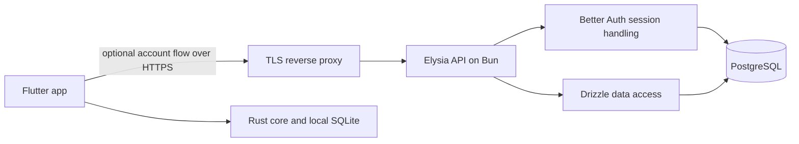

# ADR 0002: Hosted service foundation

Date: 2026-10-29  
Status: Accepted architecture; implementation and deployment pending  
Scope: The future private OpenRiver service repository and its first staging deployment

## Decision summary

OpenRiver will build its optional hosted services as a **separate private repository**. The first service will be a TypeScript application running on **Bun**, using **Elysia** for HTTP, **Better Auth** for identity and sessions, **Drizzle** for PostgreSQL access and migrations, and **PostgreSQL** for service data. Bun will also manage packages and run tests. The service will be deployed on an OpenRiver-controlled server with **Docker Compose**. The first environment is staging; production configuration and product features follow proven staging behavior.

These are architecture choices, not claims that a private repository, running service, account system, or staging deployment already exists. Exact package and image versions will be pinned in the new repository during bootstrap and tested together before deployment. This ADR supersedes the Hono, Node.js, Supabase Auth, and managed-PostgreSQL proposals in the original [technical design](../POKER_PLATFORM_TECHNICAL_DESIGN.md) for the hosted foundation. The original design remains useful for product flows and later capabilities; its illustrative cloud schema and endpoint list are not an implementation contract.

The first increment proves the service boundary: reproducible build, database migrations, health checks, Better Auth sign-in and session validation, an authenticated `GET /v1/me`, automated checks, a Compose deployment to staging, and a client-to-service authentication spike. It does not create a paid tier or enable data upload.

## Context and constraints

The public OpenRiver app is local-first. Rust owns poker rules, hand-history parsing, analytics, and the local SQLite database. Flutter owns presentation and user interaction. A player must be able to use Community features without a hosted account or network connection. Hosted services are optional capabilities, initially contemplated for AI coaching and encrypted backup. They must not become the source of truth for local hand data merely because an account exists.

The public repository has no hosted backend today. Its [`contracts/`](../../contracts/) directory is reserved for published, versioned client-service contracts. The private repository will contain deployable service code, infrastructure configuration, and secrets references; it will not copy public Rust code or store private credentials in this repository.

The stack is chosen now to make the foundation concrete. The **first commercial capability**—hosted AI coaching or encrypted backup—remains a separate product decision. It will determine later API resources, data retention, billing, metering, and provider integrations. The foundation should support either path without pretending to implement both.



The account flow is optional. The Rust core and local library continue to work when the hosted service is unavailable.

### Alternatives considered

| Earlier proposal or alternative | Decision for this foundation | Trade-off to own |
| --- | --- | --- |
| Hono on Node.js | Use Elysia on Bun, matching the chosen integrated runtime/framework. | Verify the full dependency stack on the pinned Bun release; runtime-specific behavior is part of the test surface. |
| pnpm plus a separate test runner | Use Bun's package manager and `bun:test`. | Keep explicit type checking and reproducible frozen installs in CI. |
| Supabase Auth | Use Better Auth in the service. | Operate identity data, session lifecycle, email delivery, and recovery rather than delegating them to an auth service. |
| Managed PostgreSQL | Run PostgreSQL on the user's server in Compose. | Own patching, monitoring, disk capacity, off-server backups, and restore drills. |
| Several packages and worker at bootstrap | Start with one API workspace and internal modules. | Extract a package or process later when a real second consumer exists. |

These decisions reflect the selected ownership and deployment model. They do not imply that the alternatives are technically unsuitable. The operational costs in the last column are acceptance work, not optional polish.

## Goals for the foundation

1. A new contributor can build, test, and run the API with PostgreSQL from pinned versions and one documented local workflow.
2. Staging can deploy the same tested application image with explicit configuration, migrations, health checks, and a rollback procedure.
3. Better Auth is the sole identity and session authority. Application routes authenticate through its session API and derive the account identity from the verified session.
4. The API stores and returns data only for the authenticated account. The first domain resource will supply a meaningful two-account isolation test; `/v1/me` alone cannot prove authorization of tenant-owned records.
5. The Flutter client can sign in, retain or renew its session across an app restart, call `/v1/me`, and sign out on at least one packaged native target.
6. Failures are observable without recording passwords, session tokens, private hand histories, or other sensitive payloads.

## Non-goals for the foundation

- No hosted AI inference, model-provider integration, tool loop, quotas, or usage ledger.
- No billing, checkout, subscription state, or webhook receiver.
- No cloud backup, object storage, encryption protocol, or multi-device sync.
- No worker process, message broker, Kubernetes, Terraform, or generalized plugin platform.
- No server-side copy of the local SQLite library or duplicated poker calculations.
- No production-account launch before sign-in recovery, email delivery, privacy/deletion behavior, and operational checks are defined.

These capabilities can be added through small vertical slices after the service foundation passes. Empty packages and endpoints for future modules would create maintenance obligations without proving a user flow.

## Runtime, HTTP framework, and package management

**Bun** is the runtime, package manager, lockfile owner, and test runner. The private repository will commit `bun.lock`, pin a Bun release for local development and CI, and pin a compatible `oven/bun` image for deployment. CI must use `bun install --frozen-lockfile`. A container built from that lockfile is the deployment artifact. Bun's TypeScript execution does not replace a separate type check; CI will run `tsc --noEmit` as well as tests and formatting/lint checks.

**Elysia** owns routing, request/response validation, and HTTP lifecycle. Keep `app.ts` importable without opening a listening socket, and put the actual listener in `server.ts`; this allows request tests through Elysia's `handle` method. Group routes by functioning capability. Route handlers may call domain services or repositories, but database code and auth session retrieval should be reusable without passing the whole Elysia request context through every layer. Elysia's route schemas are sufficient for the initial API; a second validation framework is not required at bootstrap.

The first direct dependencies are expected to be `elysia`, `better-auth`, `@better-auth/drizzle-adapter`, `drizzle-orm`, and a PostgreSQL driver. Development dependencies include `drizzle-kit`, `typescript`, Bun types, and a pinned formatter/linter. `bun:test` provides the initial test runner. Add the Elysia OpenAPI plugin when the first public client contract is ready to compare against the implemented routes; generated reference output alone does not decide API compatibility. Dependency versions and any additional packages must be recorded in the private repository's lockfile, not selected from `latest` during a deploy.

### Why this shape

Elysia and Bun form one runtime-specific application surface, while Better Auth and Drizzle already have documented integration points for that surface. This reduces initial adapter code. It also means Bun compatibility is a real test gate: the Better Auth session path, Drizzle queries, migration CLI, and HTTP tests must all run under the pinned Bun version before staging. Avoid adding a parallel Node runtime or a second package manager to the foundation.

## Private repository layout

The proposed repository name is `openriver-cloud`; its final Git host and owner will be chosen when it is created. Begin with one deployable application, even if the directory layout leaves room for a future worker:

```text
openriver-cloud/
├── apps/
│   └── api/
│       ├── src/
│       │   ├── app.ts                 # routes and shared HTTP behavior
│       │   ├── server.ts              # listen, shutdown, process lifecycle
│       │   ├── config.ts              # validated environment configuration
│       │   ├── auth/                  # Better Auth configuration and session guard
│       │   ├── db/                    # Drizzle connection and schema
│       │   ├── health/                # liveness and readiness
│       │   └── me/                    # authenticated account response
│       ├── drizzle/                   # committed SQL migrations and metadata
│       ├── tests/                     # route and PostgreSQL integration tests
│       ├── Dockerfile
│       └── package.json
├── infra/
│   └── compose/                       # local and staging Compose definitions
├── docs/
│   ├── adr/
│   └── runbooks/
├── .github/workflows/
├── package.json                       # private Bun workspace configuration
├── bun.lock
└── README.md
```

The root Bun workspace initially has only `apps/api`. Do not create `packages/identity`, `packages/db`, `apps/worker`, or an account web app until there is a second real consumer or a feature that needs independent ownership. A future extraction should preserve the already tested API behavior. Unit tests may sit beside the code they cover; `tests/` is for cross-module and PostgreSQL-backed cases.

## API boundary and first routes

The API will have versioned product routes under `/v1`. Better Auth's own endpoints can remain under its configured `/api/auth/*` base path; client code must treat that path and the chosen authentication method as part of its integration contract. The service initially exposes:

| Route | Authentication | Purpose | Response rule |
| --- | --- | --- | --- |
| `GET /healthz` | None | Process liveness | Return a small success response without dependencies or secrets. |
| `GET /readyz` | Deployment/internal access | Readiness | Check that the API can reach its expected PostgreSQL schema; report only ready/unready. |
| `/api/auth/*` | Better Auth protocol | Sign-in, sessions, and sign-out | Mount Better Auth's handler; do not reimplement its credentials logic. |
| `GET /v1/me` | Valid Better Auth session | Identify the caller | Return a minimal stable account representation; never accept an account ID from the request. |

`/healthz` should remain useful when PostgreSQL is down; `/readyz` should fail when database-backed traffic cannot be served. Limit external exposure of readiness details through the reverse proxy. The exact `/v1/me` fields and typed error envelope will be specified in the public contract before the Flutter client depends on them. `email`, if returned, is personal data; do not add it merely to make an endpoint look useful. The API should not return raw Better Auth database rows.

For later product routes, validate input and output at the boundary, bound payloads and pagination, return stable machine-readable error codes, and identify requests with a request ID. Any operation that can be retried with side effects must define idempotency behavior. Keep account identity server-derived in every query and write. A client's submitted `account_id`, if present at all, is never an authorization source.

### Public contract ownership

The public repository's [`contracts/`](../../contracts/) directory owns the published OpenAPI/JSON schema that Flutter consumes. Do not turn the broad endpoint sketch in the technical design into an API specification wholesale. Once `/v1/me` and auth behavior pass the native client spike, publish the reviewed first contract, generate client types only if useful, and make private CI check implementation compatibility against the latest released client contract and the next candidate. Elysia's OpenAPI output can help detect drift, but it does not silently replace the reviewed public contract.

## Identity, sessions, and account ownership

Better Auth is the single identity authority. Configure it with the Drizzle PostgreSQL adapter and mount its handler in Elysia. Use Better Auth's `user.id` as the initial stable account principal. There is no separate `accounts` table simply to mirror the auth user row. If the first paid capability needs profile or entitlement state that does not belong in Better Auth's schema, add a domain table keyed to `user.id` through a reviewed migration.

Application routes use `auth.api.getSession({ headers })` or the documented Elysia integration pattern to obtain the session. Absence, expiration, revocation, and malformed credentials all deny protected routes. Tests must prove a request cannot select another user by changing a path, query value, body field, or header. The two-account test for `/v1/me` proves each session resolves to its own identity; **record-level isolation must additionally be tested on the first tenant-owned resource**. A successful `/v1/me` response alone is not tenant isolation proof.

The first sign-in method is still open. Email/password is a simple candidate for a local and staging proof, but public accounts need verified email delivery, password reset, abuse controls, and account recovery behavior. An email-link or social method would change callback and mail/provider setup. Choose the first method before client UI implementation and document its lifecycle. Keep the Community app fully usable without signing in; the account flow is entered only for an optional hosted capability.

### Flutter session transport decision gate

Better Auth's official Elysia integration is documented. A Flutter client is a separate compatibility decision. Before standardizing a Dart library or session transport, build a packaged native spike that signs in, calls `/v1/me`, restarts the app, calls `/v1/me` again, and signs out. Cover expiration or revocation as well as the happy path. Test at least the first target OS; add other platforms before claiming support there.

Two transport candidates are acceptable for the spike:

1. **Cookie session:** retain Better Auth's ordinary session mechanism and use a native HTTP client with a secure persistent cookie store. Verify cookie domain, secure attributes, restart behavior, and logout on each supported platform.
2. **Bearer session token:** enable Better Auth's Bearer plugin only if the client needs it. Obtain the token from the documented response, store it in platform secure storage, send it only over HTTPS, and verify revocation and sign-out. If chosen, decide and test the plugin's signed-token option explicitly rather than relying on its default.

Do not assume that a community Flutter package is the protocol authority. A package may reduce client code after it passes the same spike and review of maintenance, platform coverage, and secure-storage behavior. Do not invent a custom JWT or treat the Bearer plugin's session token as a Supabase-style access JWT. The server's Better Auth session lookup remains authoritative.

## PostgreSQL, Drizzle, and schema changes

PostgreSQL is the hosted database. In local development and staging it runs as a private Compose service; only the API and a controlled migration process can reach it. Do not publish the database port to the internet. Use separate database instances or isolated databases, credentials, and volumes for staging and production. Production use of a self-hosted PostgreSQL container is conditional on a documented backup and restore test; a persistent Docker volume alone is not a backup.

Drizzle defines application tables and provides query access. Use its PostgreSQL integration through the `pg` driver for the first foundation. Bun's native SQL driver is an alternative to evaluate later if the actual integration and concurrency tests justify a change. The PostgreSQL server choice does not require a specific JavaScript driver forever.

Better Auth's CLI can generate the schema its configured version and plugins require. Review that output, incorporate it into Drizzle's schema, generate SQL migrations, and commit both schema and migration artifacts. Do not let application startup create or mutate production tables. Do not use schema push against staging or production. A migration is applied once as an explicit deployment step, by one migrator, before serving code that requires it. CI must apply all migrations to an empty PostgreSQL database and exercise a previously initialized database. Later changes need forward compatibility across an application rollout and a documented recovery path for migration failures.

In the first domain tables, add explicit `account_id` ownership and indexes appropriate to the access pattern. PostgreSQL constraints should preserve referential integrity. Application queries must include ownership scope even when identifiers are hard to guess. If database row-level security is later added as defense in depth, it supplements rather than replaces the application authorization tests.

## Deployment and environments

The same pinned application image should run locally, in staging, and eventually in production. Use Docker Compose on the user's server. The deployment topology is a TLS reverse proxy, the API container, and a PostgreSQL container on an internal network. Only the reverse proxy exposes public HTTP(S) ports. Pin image versions, run the API as a non-root user, set resource and restart limits appropriate to the server, and handle graceful shutdown so active requests and database connections close during deploys.

| Environment | Purpose | Data and credentials |
| --- | --- | --- |
| Local | Fast development and automated tests | Disposable PostgreSQL; test-only secrets and accounts. |
| Staging | Prove the deployed image and Flutter integration | Dedicated database, domain, auth secret, email/test-provider settings, and backups; no production user data. |
| Production | Later public hosted capabilities | Separate credentials, database and backup retention; launch only after operational and privacy gates. |

Compose files and a documented environment-variable template belong in the private repository. Actual secrets do not. The target server's OS/architecture, reverse proxy, DNS name, certificate method, secret-delivery mechanism, and backup destination are deployment inputs to record in the staging runbook. Keep staging and production isolated even if they share one physical server. A manual staging deployment is acceptable for the first increment; record the image digest and migration version. Production automation can follow a successful rollback exercise.

### Backup and rollback

Define a PostgreSQL backup schedule with an **off-server** destination, retention, and a restore drill. Test a restore into a separate database and verify Better Auth tables, schema version, and representative account data. Do not treat an image rollback as a database rollback: schema changes may have advanced. Make schema changes additive when possible; for a failed deploy, first roll back the application to a compatible image, then follow the documented database recovery procedure if needed. Keep the reverse proxy and database configuration in version control without committing secrets.

## Security and observability

The foundation's trust boundary is the Elysia API. TLS terminates at the reverse proxy; it forwards only expected traffic. Better Auth owns credential verification. The API owns authorization of product resources. PostgreSQL is private to the service network. Rate-limit public auth endpoints, bound request sizes, configure allowed origins deliberately, and do not expose account data through health responses or stack traces. Environment configuration must fail closed when a required secret, base URL, or database URL is missing.

Use structured logs with request ID, route, status, duration, and a non-sensitive account reference after authentication. Exclude passwords, cookies, `Authorization` headers, session tokens, full request bodies, raw prompts, hand histories, and database URLs. Record failed sign-in and authorization outcomes without enough detail to disclose whether a particular account exists. Staging needs alerts or a documented check for API unavailability, repeated readiness failure, disk usage, and failed backups. Add deeper tracing and cost metrics with the first hosted capability; there is no AI spend to meter in the foundation.

Before public accounts, document retention, account deletion, access to stored personal data, incident response, and the applicable privacy notice. Hosted AI and backup will each need their own data-flow and threat-model review before any hand data leaves the device.

## Automated verification and acceptance

The private repository CI should run, from a clean checkout:

1. Frozen Bun install, formatter/linter check, and TypeScript type check.
2. Bun unit and request tests using an importable Elysia app.
3. PostgreSQL-backed integration tests that apply committed migrations to a fresh database and check Better Auth sign-in, session lookup, revocation, and `/v1/me` for two distinct users.
4. A test that denies missing, expired, or invalid credentials without leaking account details.
5. Container image build and a Compose smoke test for liveness and readiness.
6. A migration check that a database already at the current schema can start the new image without unexpected schema mutation.

Staging acceptance additionally requires a clean deploy, TLS access to health and authenticated routes, a client session restart test on a packaged native target, a tested off-server PostgreSQL restore, and a documented image rollback. The first tenant-owned product resource must add a cross-account read/write isolation test before that capability is considered complete. A passing `/v1/me` test does not waive that gate.

No checklist item in this ADR is marked complete merely because it has been designed. Record exact commands, versions, target environment, and results in the new repository's verification log as implementation proceeds.

## Implementation order and handoff to the private repository

1. Copy this ADR into the new private repository and record any changes there. Keep a link or short summary here so the public client's contract decisions remain discoverable.
2. Bootstrap the Bun workspace, pin dependencies, create the importable Elysia app, and add local Compose with PostgreSQL.
3. Configure Better Auth with the Drizzle adapter. Generate and review its schema, commit the first migration, and implement health/readiness routes.
4. Implement session-protected `/v1/me` and the local tests. Select the initial sign-in method and exercise both authorized and unauthorized flows.
5. Build the API image and deploy staging with isolated configuration, TLS, backups, and a rollback runbook.
6. Run the Flutter native session spike, settle cookie versus Bearer transport, and publish the first reviewed public contract.
7. Select the first hosted capability and implement its client, service, authorization, operational metrics, and failure path as one vertical slice.

## Open decisions and triggers

| Decision | Needed before | Current default or question |
| --- | --- | --- |
| Private repository location and access | Repository creation | Name `openriver-cloud` is proposed; owner/visibility are not configured. |
| First sign-in method | Client auth UI and public accounts | Email/password is a local-test candidate; email verification and recovery must be designed for launch. |
| Flutter cookie or Bearer transport | Client integration contract | Decide by packaged native spike. |
| Initial target OS for hosted sign-in | Native spike | Choose from actual supported Flutter targets; do not infer support from a package listing. |
| Staging domain, proxy, and server details | Staging deployment | Use the user's server; record its existing proxy and certificate setup. |
| Secret delivery and off-server backup destination | Staging deployment | Must be configured and tested; never commit credentials. |
| First hosted capability | Product routes beyond `/v1/me` | Hosted AI or encrypted backup; no adefault is imposed by this ADR. |
| Public API response/error schema | Flutter dependency on `/v1/me` | Review and publish a minimal versioned contract after the session spike. |

## Risks and review points

- **Flutter interoperability:** Better Auth's documented server integration does not by itself prove a secure, durable session on every Flutter target. The native spike is a release gate.
- **Bun integration:** Run the actual Better Auth, Drizzle, `pg`, and Elysia combination under the pinned Bun version in CI and Docker. A library's TypeScript types are not runtime proof.
- **Self-hosted database recovery:** Compose persistence protects against container replacement, but server or disk loss needs off-server backup and a verified restore.
- **Account isolation:** A verified session identifies a caller; every product resource still requires ownership checks and two-account tests.
- **Contract drift:** Elysia can generate OpenAPI reference output, while the public repository publishes the client contract. CI must compare them once the contract exists.
- **Scope growth:** Auth plugins, worker infrastructure, and billing are added for an actual use case, with their own migrations and verification, rather than all at bootstrap.

## References

- [Elysia request testing](https://elysiajs.com/essential/route) and [Better Auth integration](https://better-auth.com/docs/integrations/elysia)
- [Bun workspaces](https://bun.com/docs/pm/workspaces) and [Bun Docker guide](https://bun.com/guides/ecosystem/docker)
- [Better Auth Drizzle adapter](https://better-auth.com/docs/adapters/drizzle) and [Bearer plugin](https://better-auth.com/docs/plugins/bearer)
- [Drizzle PostgreSQL setup](https://orm.drizzle.team/docs/get-started-postgresql) and [migration workflow](https://orm.drizzle.team/docs/migrations)
- [Elysia OpenAPI plugin](https://elysiajs.com/plugins/openapi)
- [Docker Compose deployment guidance](https://docs.docker.com/compose/how-tos/production/)
